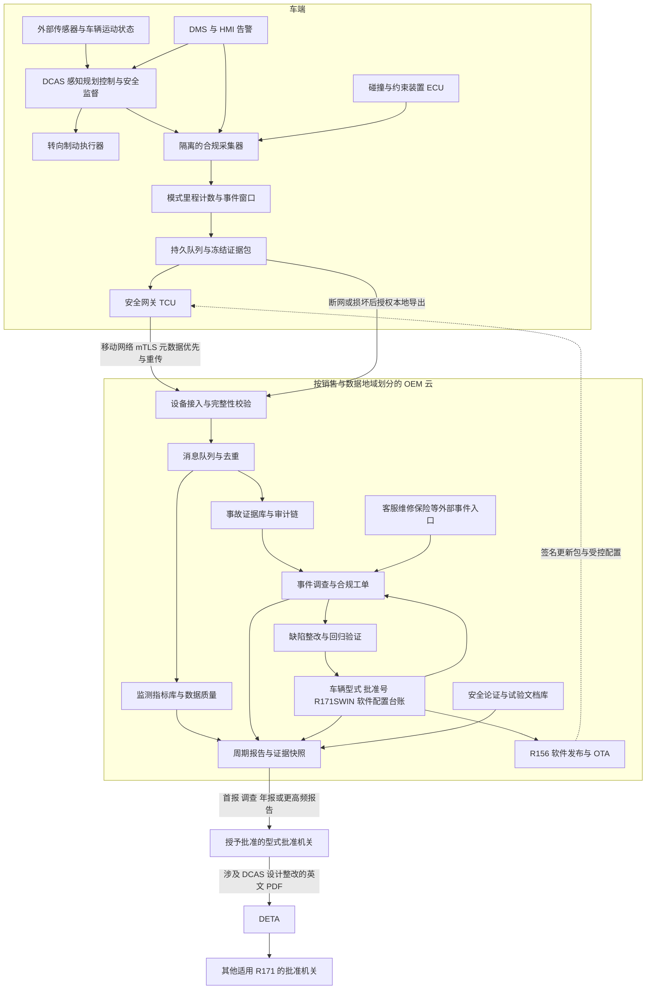

# R171 VTA 车云架构与监管数据方案

核查日期：2026-10-11（Asia/Shanghai）。VTA 按 Vehicle Type Approval（车辆型式认证）理解；本文设计的是支撑 DCAS 型式批准及获批后持续合规的企业系统。

交付图：[架构图 PNG](../diagrams/2026-10-11T145500/diagram.png)、[架构图 SVG](../diagrams/2026-10-11T145500/diagram.svg)、[Mermaid 源码](../diagrams/2026-10-11T145500/diagram.mmd)。SVG 已解析并通过本地浏览器渲染，PNG 已目视检查；未进行真实车辆及主管机关接口测试。

## 1. 可以确定的结论与证据边界

UN R171 规范的是装有 Driver Control Assistance Systems（DCAS）的车辆型式批准，不是独立云平台产品认证。DCAS 为驾驶员持续负责的驾驶辅助系统，不能把 R171 批准理解为无人驾驶批准。云端日志和报告只能支撑批准，不能替代车端安全性能、驾驶员监测、试验、管理体系及批准文件。

公开可核验的已获批例子是新 BMW iX3：BMW 于 2025-10-30 明确宣布获得 UN Regulation No.171/DCAS 批准。该公告未公开批准证书全文、具体批准编号、适用修订系列、全部功能批准边界或后台组件，因此不能据此确认 BMW 后台采用本报告架构，也不能声称某款商业 VTA 平台已被 R171 单独认证。

截至核查日期，法规版本必须精确管理。已核对的 01 系列于 2025-09-26 生效；RDW 于 2026-10-02 更新的生效日期表记载：00 系列已有 Supplement 3、01 系列已有 Supplement 1，均于 2026-06-04 生效。本文的完整监测指标按 **01 系列及 Supplement 1** 设计；00 系列车辆按实际批准适用规则输出报告。不能把 2024 年原始条文当作当前全部要求。

版本核对依据包括 EUR-Lex 的 01 系列官方公布全文、UN 文件 ECE/TRANS/WP.29/2025/144、WP.29/1188 的通过记录以及 RDW 生效日期表。没有取得每一辆车的正式批准文件，因此本文是可实施的参考方案，不是对特定车辆作出的认证结论。正式申报须对照适用缔约方、车辆类型、批准号、修订系列及补充条款。

## 2. 公开实践及其可借鉴之处

| 案例 | 有来源支持的事实 | 可以借鉴 | 不能推出的结论 |
|---|---|---|---|
| BMW 新 iX3，2025-10-30 官方公告 | 明确获得 UN R171/DCAS 批准；公开说明高速辅助、驾驶员视线确认变道及驾驶员保持注意力 | 以功能、使用边界、驾驶员参与和软件版本组织批准证据 | 未披露完整车云平台，也未公布该公告涵盖的全部批准细节；不能把所有未来 OTA 功能都视为已经获批 |
| RDW 对 Tesla 欧洲版 FSD Supervised 的监督，2026-04-10 与 2026-06-17 官方说明 | 取得当时有效范围限于荷兰的批准；核验厂家数据完整性、可验证性、准确性及统计分析；独立测试；将年报临时提高为月报 | 数据可审计、独立验证、获批后持续监测、报告周期可配置 | 该资料不能证明标准 R171 批准覆盖所有功能和国家；未取得批准证书及豁免清单；不能将美国版本等同于欧洲版本 |
| BMW 欧洲客户车辆图像采集，2026-09-07 官方说明 | 为研发改进开展事件触发的外部图像与传感器数据采集，需客户同意；最长 120 秒/事件；传到后台后删除 VIN；人工查看前尽可能模糊人脸及号牌 | 可选研发数据使用独立权限、事件窗口和隐私处理 | 120 秒不是 R171 法定记录长度；客户同意机制不是所有 R171 法定义务处理的唯一法律基础；研发去 VIN 方案不能直接替代事故取证可追溯性 |

实践组合：采用获批车型体现的车端安全与功能边界，采用 RDW 体现的数据核验与持续监督机制，采用独立的研发图像治理。没有公开证据支持“某家后台是全球最佳、购买后自动满足 R171”。

## 3. 法规直接要求的监管数据

### 3.1 事故和通报

依据第 2.27、7.1、7.2.1、7.2.2 段：Safety-Critical Occurrence 的碰撞后果包括至少一人受伤且需要医疗援助，或本车安全气囊、不可逆乘员约束装置、弱势道路使用者二次安全系统触发。后果和辅助功能的时序需同时核对；不是所有急刹车和碰擦都自动达到该定义。厂家知悉伤情可以来自客服、维修、保险或主管机关，不能只依赖气囊报文。

- 一般通知范围：事故时系统/功能处于 On，或事故前 5 秒内曾切换到 On。On 包括 Active 和 Stand-by，不能只筛选碰撞时 Active。
- 01 系列系统发起动作另有范围：有关功能在事故前 7 秒内曾 Active。不能用通用 5 秒规则覆盖全部情况。
- 首报：无不合理延误，提供当时可得的高层事故信息，以及相关功能 On 状态信息。地点、时间、事故类型是条文示例；数据缺失要明确记录，不能捏造完整字段。
- 调查报告：尽快给出事故是否关联 DCAS 的调查结果；若 DCAS 很可能是原因之一，提供拟开展的相关设计整改。首报不应等待最终责任鉴定。
- 首报/调查报告未统一规定厂家必须“24 小时”或“7 天”提交。企业响应 SLA 和主管机关具体要求应单独配置。

通知范围、碰撞后果和 DCAS 因果关系是不同判断：发生重大后果且落入通知时序范围时不能仅因尚未证明 DCAS 为事故原因而等待调查结束后才首报。第 2.27 段的定义与第 7.2.1 段扩展的事故前状态窗口应同时实现。

### 3.2 周期报告：01 系列第 7.2.3.1 段 Table 1 全部九项

除表中另有规定，表头要求事件总数及相关运行小时、行驶距离。重大系统变更需在报告中区分，不能将变更前后的车队表现无区别混合。

| 序号 | 必须报告的内容 | 建议车端/企业源数据 |
|---|---|---|
| 1 | 厂家知悉的重大安全事件 | 事件 ID、碰撞时间、相关模式/功能、后果、厂家知悉时间；客服/维修补录 |
| 2 | 配备系统的车辆数；Passive 和 Active 模式累计里程 | 车辆配置台账、模式时序、车端累计里程；不能用活跃联网数代替配备车辆数 |
| 3 | 导致驾驶员不可用响应的事件数 | 不可用响应启动时刻、原因、响应状态 |
| 4a–4c | 系统主动退出次数，按检测到故障、超出系统边界、其他原因分类 | 退出发起方、被退出功能、原因枚举、时间；区分驾驶员主动关闭 |
| 5 | Active 状态下，驾驶员设定限速高于系统确定限速的里程占比 | 两种限速、Active 里程增量、超限条件下里程增量 |
| 6a | 按 5.5.4.2.8.2 因注意力不足导致的系统禁用次数 | 禁用触发规则、事件时间、规则版本 |
| 6b | 上述禁用后不足 5 分钟关闭动力系统的次数 | 禁用时刻、powertrain deactivation 时刻；不是高压电池故障的同义词 |
| 6c–6d | 因重复 EOR 或 HOR 导致禁用的次数，及厂家定义的告警数与时间间隔 | 告警类别、禁用关联、已向批准机关说明的告警阈值及窗口版本 |
| 7a–7b | Active 期间，10 分钟内出现 5 次 EOR 或 5 次 HOR 的事件数；记为事件后重置相应计数 | 每种告警的发出时刻、Active 状态、独立窗口计数及重置轨迹 |
| 8a–8b | 适用时，在免 HOR 阶段且驾驶员未覆盖纵向控制，检测到即将到达系统边界后提前至少 5 秒／不足 5 秒发出 HOR 的次数 | HOR-withheld 状态、纵向覆盖状态、边界判定及 HOR 时间 |
| 8c | 免 HOR 阶段的行驶距离与时长 | HOR-withheld 分段里程、时长；这是统计阶段定义，不是只看方向盘是否被握住 |
| 9 | 适用时，中止的系统发起动作次数 | 动作 ID、类型、发起者、开始/中止/结束状态及原因 |

EOR = Eyes On Request（要求恢复视线关注）；HOR = Hands On Request（要求手回到方向盘）；DCA = Direct Control Alert（要求立即恢复直接控制）。第 6、7 项以及第 8、9 项适用内容不能在按 01 系列设计时漏掉。

周期报告至少每年一次，01 系列表述延续至按第 14 段正式永久停产；第 14.2 段明确，若仍计划为已上市车辆软件更新申请后续批准，不视为永久停产。更高报告频率可以成为实际监督要求，例如 RDW 对上述 Tesla 案例采用月报。

### 3.3 批准、软件和生产一致性证据

| 数据 | 依据 | 企业平台如何提供 |
|---|---|---|
| 功能类别、工作速度、道路类型、激活前提、系统边界、车辆系统交互、退出及覆盖方式、驾驶员脱离监测标准和机制 | 第 9 段；第 5、6 段相关性能要求 | 版本化功能与边界清单，和测试、安全分析关联 |
| 系统安全分析、组织安全管理过程、供应商接口与证据 | 附件 3 | 受控文档库、审计记录、责任人及供应商证据引用 |
| 场地与公共道路试验；若使用虚拟测试，其可信度评估 | 第 8 段、附件 4、5 | 测试配置/版本、结果、失败处置、仿真与实测相关性 |
| R171SWIN、相关 ECU 软件版本与批准之间的对应关系，以及读取方式；R156 符合性 | 第 10 段 | 版本注册表和可审计映射；R171SWIN 可以不保存在车上，但须向批准机关声明版本映射 |
| 车辆型式变更、批准修订/扩展或新批准、生产一致性 | 第 11、12 段 | 软件/标定/模型/功能开关变更评估、批准范围检查、出厂和 OTA 安装清单 |

模型权重、标定或云端功能配置如果影响批准特征，也需进入变更影响评估；不能只检查软件包名称是否变化。R171 第 10.2 段明确关联 R156；R155、EDR 等应按车型及市场适用要求单独管理，不能把其所有数据规则算作 R171 的直接要求。

### 3.4 没有被这些条文统一强制的事项

R171 没有在上述条文中统一要求：全部摄像头/雷达原始数据持续上云、DMS 原始人脸视频上云、统一车云协议、云服务商、全车数据固定采样率、统一监管遥测 API、事故视频统一前后记录时长或所有原始数据保存十年。

但“没有统一字段/频率”不等于“无需任何取证”：厂家仍须建立有效监测、提供报告、回应调查请求，批准机关也可以提出具体证据要求。

附件 3 第 3.1.1 段有明确文件留存要求：正式批准文档应至少在车辆永久停产后十年可用；由厂家持有的特定保密安全分析材料和数据也应在永久停产后十年可用。该条不能泛化成所有行车视频或所有遥测数据一律保留十年。

## 4. 完整车云参考架构

本文架构为建议设计，不是 BMW 或 Tesla 内部架构的复原。

### 4.1 车端

1. **驾驶安全闭环**：感知、规划、控制、安全监督、DMS/HMI、退出与风险减缓均在车端实现。采集服务与控制服务隔离，上传失败或云不可用不应破坏车辆安全行为。DMS 原始图像优先车端处理，合规统计使用结构化状态及告警。
2. **法规采集器**：从 DCAS、DMS/HMI、车辆动力学、碰撞与约束 ECU 获取所需状态。依据批准的功能状态机记录 Off/On/Active/Passive/Inactive，按功能和整套系统定义避免重复累计。使用车端单调时钟排序，并保存 UTC 映射、不确定度及跨 ECU 时间同步质量。
3. **边缘计数器**：持久累计模式里程、运行时长、各类事件次数；独立实现告警窗口、禁用关联和动力系统关闭判断。事件序号与累计值双轨，支持云端差分、重算和缺失检测。
4. **事件缓存与冻结**：建议结构化关键信号预缓存 30 秒、事后 30 秒；这是可调整的工程起点，不是法规时长。至少要能还原 5 秒和适用的 7 秒通知范围及相关完整状态转变。碰撞、风险减缓、关键故障等触发优先持久化；重要事故包在核验和案件留存期内不得被普通环形缓存覆盖。后续才知悉医疗后果时，以已有结构化记录与售后证据补充，不能保证事后取得从未保存的原始影像。
5. **安全网关/TCU**：设备独立身份、证书与密钥保护、加密存储、包签名、压缩、分片、持久队列、上传确认和断点续传；断电可用性与存储写入时机按安全目标验证。EDR 如适用独立实现，不以合规遥测记录器宣称替代 EDR 认证。

### 4.2 OEM 云端

- **接入**：按地域选择接入域，验证车辆证书、包摘要、序号和 Schema；消息队列允许至少一次投递，消费者幂等。先接收轻量事故元数据，再接收完整证据；隔离非法或无法解析数据并告警，不能静默丢弃。
- **证据库**：加密对象存储、不可变快照/受控留存锁、签名校验、原始文件摘要、数据出处、导出/转换/访问审计；案件保存依据用途与期限，受理期间设法律保全。签名支持完整性核验，但并不自动证明传感器内容绝对真实。
- **指标与质量**：版本化计算任务；关联车端累计值与事件明细；监督失联车辆、漏报、重复、时间漂移、异常回滚、分母缺失。报告真实覆盖率、估算方法及不确定性；失联车辆不能简单作为零事故。
- **报表分组与追溯**：每条统计记录关联车辆型式、批准号、R171SWIN 或版本映射、功能范围、报告期间和地域；实现模式里程、超限条件里程、相关运行小时与事件计数的统一口径。注意厂家的配备车辆台账和已采集数据车队不是同一个集合。
- **合规台账**：VIN/假名 ID 与车辆型式、批准机关、批准号、R171 修订系列/补充版本、批准功能、R171SWIN、实际 ECU/模型/标定/配置建立时间有效的映射。身份映射放入单独的高权限保险库。
- **调查**：遥测与客服、维修、保险及主管机关来函合并；记录首次知悉、后果确认、相关功能、初报、调查、整改、复验和回执。自动预分类后人工核验；数据不足也要保留事件并进入调查。
- **报告与文档**：按批准机关及车辆型式生成有版本的首报、调查、周期报；可配置月报/季报/年报；附原始计数、暴露量、软件分组、覆盖率、计算口径和证据索引。数据快照/计算代码/报告相互可追溯。
- **整改与发布**：安全问题进入缺陷管理；回归试验和安全论证更新；按第 11 段判断修订、扩展、新批准或补充测试；满足适用批准条件后通过 R156/SUMS 流程发布，记录目标车辆和实际安装结果。不能以远程功能开关绕过型式变更评估。

### 4.3 数据治理和运行约束

车云安全可采用 HTTPS/TLS 1.3、mTLS、JSON/Protobuf 元数据、加密对象存储及短期授权上传地址；这些是实现选择。按部署市场评估 GDPR 或当地隐私、汽车数据及跨境传输要求。欧洲原始证据优先在欧洲区域存储和分析，跨境共享只在有明确目的与合法机制时开展；本地化架构是建议，不能说 GDPR 一概禁止跨境。

法定合规与可选研发使用不同处理目的、字段、权限、保留策略及适用法律基础；客户撤回研发同意不应自动导致合法合规处理停摆。假名化仍可能是个人数据。事故可追溯身份与研发匿名/去标识图像分别管理。

运行要求：主管机关通道中断时排队、升级并记录；保留发送包、发送时间、收件与审批回执。身份权限最小化，研发人员通过脱敏副本工作。证据保留、普通统计、可选图像与长期批准材料使用独立留存类别。

## 5. 数据传输链路及责任

| 链路 | 数据及传输 | 触发/频率 | 义务属性及责任 |
|---|---|---|---|
| ECU → 车端采集器 | CAN-FD/以太网：模式、功能、告警、退出、动作、碰撞和运动状态 | 关键状态事件触发；持续状态按还原需求采样 | 协议/采样率为建议；OEM 对监测有效性负责 |
| 采集器 → 持久存储 → TCU | 签名事故清单、结构化证据、累计统计；可选影像独立通道 | 事故优先；统计按行程结束或每日批量，具体均为建议 | R171 不统一规定遥测上云周期 |
| TCU → OEM 地域云 | 移动网络/可用网络上的 mTLS；元数据优先、分片重传、校验确认 | 网络可用及时传输；离线持久缓存并授权本地导出 | 没有“断网即免除知悉后通报”的规则；OEM 持续跟进 |
| 客服/维修/保险/批准机关 → OEM 调查系统 | 时间、伤情是否需要医疗、维修/事故信息及关联车辆 | 一旦收到安全线索立即受理 | 支持厂家知悉范围；外部事实须标记来源与置信状态 |
| OEM → 授予批准的 Type Approval Authority | 初报、关联性调查、拟整改、周期报告、应要求提供的资料 | 首报无不合理延误；调查尽快；至少每年一次或更高监督频率 | 第 7 段直接规定；具体安全门户/API/文件方式与该机关商定 |
| 批准机关 → DETA | 涉及 DCAS 设计整改的英文 PDF：事故、原因、整改；关联批准号，OTHER 文档及 News 通知 | 无不当延误且最迟收件后 14 天 | Supplement 1 第 7.2.2.2 段及附件 6；承担者是批准机关 |
| DETA → 其他适用 R171 的批准机关 | 受控查看上述整改材料 | 通知/查询 | 不是公众实时遥测库，也不是所有年报自动写入 DETA |
| OEM 发布系统 → 车辆 → OEM 台账 | 签名更新包/配置；安装前检查；版本及结果回传 | 经验证和适用批准流程后分批更新 | 第 10、11 段与 R156；具体 OTA 协议为建议 |

DETA 附件 6 还规定信息的安全保护与用途限制。整改材料仅向适用 R171 的缔约方提供；标准 News 通知可由 DETA 用户看到。News 不是邮件系统，默认两个月到期不代表事故证据只需保存两个月。

## 6. 两个实施例

**事故前退出的例子**：车辆在 14:02:00 碰撞并触发安全气囊，DCAS 在 14:01:57 退出。车端保存此前 On 的状态及时间，云端按第 7.2.1 段关联窗口核对；不能因碰撞瞬间已 Off 就自动剔除。先提交当时可得的事故和功能信息，再调查 DCAS 是否为原因。对适用的系统发起动作，还需覆盖事故前 7 秒内有关功能 Active 的情形。若确定需整改，OEM 交批准机关，批准机关在上述期限内上传 DETA。

**周期统计的例子**：某批准型式在一个报告期间配备系统的车辆数为 10,000，Active 累计里程 12,000,000 km，Passive 里程 1,000,000 km；Active 时驾驶员设定限速超过系统确定限速的里程为 600,000 km，则占比为 5%。不得除以 Active+Passive 里程。若系统版本在期中有重大变化，应区分前后版本；报告还须补齐其余八项指标、对应运行暴露量和覆盖说明。

同类事件率建议按同一软件分组、功能范围及工况计算，并同时展示事件数与运行小时/里程。没有发生事故不等于证明绝对安全，公开车队里程也不能直接用于比较不同道路和驾驶员条件的系统安全性。

## 7. 方案验收

1. 车端性能满足适用第 5、6 段并完成附件 3/4 审查试验；仿真证据若用于批准，满足附件 5 的可信度评估。
2. 01 系列 Table 1 九项均有字段、计数规则、暴露量和报告映射；不适用有功能与批准依据。
3. 回放覆盖事故前 5 秒与适用 7 秒场景、Passive/Active 区分、告警窗口计数后重置、禁用后 5 分钟动力系统关闭等。
4. 网络中断、掉电、重复重传、乱序、未知 Schema、ECU 时钟漂移和缓存满时，证据与累计值质量可检测、可恢复；问题不静默记零。
5. 软件升级跨版本后能按批准/版本拆分指标，可还原事故当时实际配置；批准文件与特定保密分析材料符合附件 3 留存要求。
6. 完成首报、调查、整改、周期报与主管机关回执的端到端演练，明确 14 天 DETA 时限属于批准机关环节。

本文没有进行真实车辆试验、主管机关联调或型式认证；验证成果限于公开条文、公开案例与设计一致性核对。

## 8. 原始来源

- [S1：R171 01 系列官方公布文本（EUR-Lex 2025/1899）](https://eur-lex.europa.eu/legal-content/EN/TXT/?uri=CELEX:42025X1899)，重点第 2、7、8、9、10、11、14、16 段与附件 3。
- [S2：01 系列 Supplement 1 文本，ECE/TRANS/WP.29/2025/144](https://docs.un.org/en/ECE/TRANS/WP.29/2025/144)，重点第 7.2.2.2 段及附件 6。[通过记录 WP.29/1188](https://docs.un.org/en/ECE/TRANS/WP.29/1188)。
- [S3：RDW ECE 法规生效日期表](https://www.rdw.nl/-/media/rdwnl/documenten/fabrikanten/naslag/entry-dates-ece-regulations.pdf)，核对 2026-10-02 版本 R171 项，PDF 内页码 85。
- [S4：BMW 于 2025-10-30 宣布新 iX3 获 DCAS 批准](https://www.press.bmwgroup.com/global/article/detail/T0453593EN/smart-safe-symbiotic:-bmw-group-is-the-first-car-manufacturer-in-germany-to-receive-international-approval-for-innovative-assistance-systems-in-accordance-with-the-new-dcas-regulation)。厂家公告证据，不替代批准证书。
- [S5：RDW 于 2026-06-17 说明 FSD Supervised 的数据核验和在用监督](https://www.rdw.nl/en/news/2026/explanation-of-the-type-approval-of-fsd-supervised)；[2026-04-10 对批准地域和欧洲版软件的说明](https://www.rdw.nl/en/news/2026/rdw-explanation-of-european-type-approval-tesla-with-provisional-validity-in-the-netherlands)。
- [S6：BMW 于 2026-09-07 说明欧洲客户车辆事件图像采集](https://www.press.bmwgroup.com/global/article/detail/T0460397EN/bmw-group-is-expanding-collection-of-image-data-from-bmw-customer-vehicles-in-europe-to-drive-continuous-product-improvement-and-enhance-road-safety)。研发采集示例，不作为 R171 统一字段/长度规定。
- [S7：00 系列 Supplement 3，ECE/TRANS/WP.29/2025/143](https://docs.un.org/en/ECE/TRANS/WP.29/2025/143)，涉及 00 系列功能边界及 DETA 条款，勿与 01 系列混用。

官方公布文本提示国际法上的效力以 UN/ECE 原文为准，生效状态须对照 WP.29/343。本文以官方公布全文、联合国通过文本和主管机关日期表交叉核验，未将仍为草案的内容直接视为已生效。
