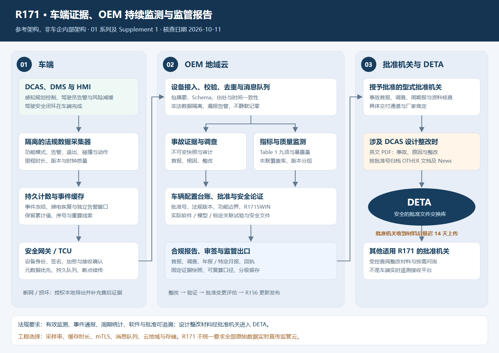

# R171 合规方案

UN R171/DCAS 车辆型式批准、在用监测与车云数据架构参考资料。

本项目中的 VTA 指 Vehicle Type Approval（车辆型式认证）。内容核查日期为 **2026-10-11**，完整指标方案按 **R171 01 系列及 Supplement 1** 设计；具体车型仍须按实际批准版本、功能范围及销售市场执行。

## 文档与架构

- [完整车云架构与监管数据方案](.doc/R171-VTA车云架构与监管数据方案-2026-10-11.md)
- [多域汇聚与 Momenta 接口方案评审](docs/R171-多域汇聚与Momenta接口方案评审-2026-10-12.md)
- [架构图 PNG](diagrams/2026-10-11T145500/diagram.png)
- [架构图 SVG](diagrams/2026-10-11T145500/diagram.svg)
- [Mermaid 架构源文件](diagrams/2026-10-11T145500/diagram.mmd)
- [来源索引及采集摘要](.doc/research-r171/sources-manifest.json)
- [来源留存说明](.doc/research-r171/README.md)
- [版本记录](CHANGELOG.md)



## 内容范围

涵盖公开获批案例与证据边界、01 系列九项周期报告指标、重大安全事件通报、车端采集与证据缓存、OEM 云端调查与统计、软件批准追溯，以及批准机关向 DETA 交换设计整改材料的链路。

这是参考设计，不是车型或云平台的认证证书。公开案例不代表车企采用本项目架构；R171 也不等于无人驾驶批准。已完成条文和方案一致性核对，未进行真实车辆试验或主管机关接口联调。

## 本地渲染

需要 Python 3 和已安装的 Microsoft Edge。脚本不安装依赖；默认使用 Windows Edge 路径，也可用参数指定浏览器。

```powershell
python .doc/research-r171/render_architecture.py
python .doc/research-r171/render_architecture.py --browser "C:/Program Files (x86)/Microsoft/Edge/Application/msedge.exe"
```

渲染生成 PNG 与本地预览文件；浏览器用户目录和预览文件不纳入版本管理。SVG 为静态交付图，Mermaid 为方案中的逻辑架构，修改时需同步复核两者。

## 版本管理

- 稳定资料保存在 `main` 分支，初始版本为 `v0.1.0`。
- 后续修改先更新方案、相关图和 `CHANGELOG.md`，再提交；适用法规有变化时更新核查日期和来源。
- 第三方网页全文、搜索结果、浏览器缓存及工作区无关资料通过忽略规则排除；来源事实和官方链接在文档与索引中记录。
